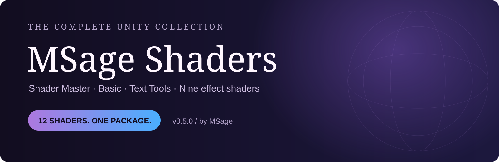

# MSage Shaders

A complete shader collection for Unity creators: **Shader Master**, **Basic**, **Text Tools**, and **nine dedicated effect shaders**, with matching material inspectors and shared authoring resources.

**[Download v0.5.0](https://github.com/MSage3D/shader-master-by-msage/releases/latest)** · **[Shader guide and interactive wiki](https://msage3d.github.io/shader-master-by-msage/)** · **[MSage Discord](https://msage.co/discord)**

## One package. Twelve shaders.

Import **MSage.Shaders-v0.5.0.unitypackage** to install the full collection. Every shader appears under **MSage Shaders** in the material Shader menu. The package includes shader source, includes, custom inspectors, editor services, fonts, font atlases, icons, the Name Tag prefab, examples and documentation.

| Shader | Use it for | Included material controls |
| --- | --- | --- |
| **Shader Master** | All features in one material | Main, emissions, MatCaps; full shading, all FX, Text Tools and dissolves. |
| **Basic** | Everyday material authoring | Base, color-shift, normal and alpha maps; emissions, MatCaps, shadows, rim, metallic/roughness and outline. |
| **Text Tools** | Name tags, signs and animated text | Font atlases, alignment, fitting, sub-text, icons, borders, transparency and optional outline. |
| **Galaxy** | Animated deep-space surfaces | Base/normal/alpha, emission, shadows and rim. |
| **Glitter** | Sparkling fabric and coated surfaces | Emission, MatCaps, shadows, rim, metallic/roughness, clear coat and cloth. |
| **Force Field** | Transparent energy shells | Base/normal/alpha, emission and rim; Fade, two-sided, depth writes off by default. |
| **PlayStation** | Retro geometry and texture rendering | Base/normal/alpha, emission, MatCaps and shadows. |
| **Hologram** | Glitching emissive projections | Base/normal/alpha, emission and rim; transparent and two-sided by default. |
| **Eye** | Procedural iris and pupil authoring | Base/normal/alpha, emission, realistic shadows, roughness/specular and clear coat; metallic amount starts at zero. |
| **Dream** | Painterly and memory-image effects | Base/normal/alpha, emission, shadows and rim. |
| **Temporal Split** | Staggered colored silhouettes | Base/normal/alpha, emission, MatCaps, shadows and rim; all four silhouette passes retained. |
| **Living Illustration** | Ink, paper and crosshatching | Base/normal/alpha, emission, shadows and AO. |

**Outline FX remains an optional supporting feature**, rather than a separate shader. Shader Master keeps its full feature set, including the surface treatments, Text Tools and Dissolves & Transformations. The dedicated shaders expose their own relevant controls and exclude unrelated effect gates from their compiled material layout.

## Choose a starting point

- Use **Basic** for ordinary textured materials with lighting, emission, MatCaps and outline support.
- Use **Shader Master** when a material needs multiple effect systems, advanced surfaces, transformations or optimized shader locking.
- Use a **dedicated effect shader** when the material has one visual purpose.
- Use **Text Tools** for Name Tags, Large Tags and Typing Text Variations. It starts unlit and transparent for readable text.

Each dedicated effect retains base color, normal and alpha maps, independent UV selection/tiling/offset/panning, global color adjustments, render controls and optional outline. Emission, MatCap and shading availability varies as listed above. Compatible property identifiers are shared, so switching shaders carries compatible texture and material values; existing materials are not automatically switched.

## Installation and upgrades

1. Download the complete package from [Releases](https://github.com/MSage3D/shader-master-by-msage/releases/latest).
2. Import it into a Unity project using the **Built-in Render Pipeline**. Keep both product folders and all dependencies selected.
3. Wait for Unity to finish importing and compiling scripts.
4. Create or select a material and choose **MSage Shaders → your shader**.
5. Start with the [shader catalogue](https://msage3d.github.io/shader-master-by-msage/#shader-catalogue), then open the relevant Main, Shading or effect controls.

The historical folders <code>Assets/Shader Master by MSage</code> and <code>Assets/Shader Master Effects</code> remain in use for upgrade compatibility. They are parts of the same **MSage Shaders** package. Existing Shader Master GUIDs, serialized property names, shader identity <code>MSage Shaders/Shader Master</code>, and generated animation identifiers are preserved. Tara's existing SDK shader is unchanged; this collection's copy is <code>MSage Shaders/Basic</code> with a distinct inspector identity.

## Authoring tools

Open **MSage → MSage Shaders → 3. Creator Tools** for multi-material tools, compatible property copying, non-destructive conversion to Shader Master, texture detection, presets and optional VRChat toggle tooling. Material targeting recognizes the collection's shader family. Conversion still explicitly targets the all-features **Shader Master**.

The Name Tag prefab is available under **MSage → MSage Shaders → 2. Prefabs → Name Tag**. New copies use **Text Tools** and receive their own material.

The searchable MSage inspectors retain scoped Copy, Paste, Save and Reset controls. Fonts, icons and tooltips are included in the full package. Basic has no Tara SDK dependency. VRChat-specific editor tools are conditional on the VRChat Avatars SDK.

## Shader Master optimization

**Lock Optimized Shader** and **Unlock Optimized Shader** remain specific to Shader Master. Its optimizer preserves animation-bound properties and Toggle Targets, removes unused optional passes, and produces portable locked shaders with recovery companions. Automatic Shader Master locking during VRChat avatar preprocessing remains available. Dedicated effect shaders already exclude unrelated effect gates; the package does not claim that its master-only optimizer locks every shader in the collection.

Hyper Cell and Hyper Realistic retain their authored camera behavior and their Cell/Realistic fallback for mirrors and the VRChat camera. AudioLink preview sliders are editor-only and reset before builds/uploads.

## Compatibility and verification

The collection targets Unity's **Built-in Render Pipeline**. Release verification uses **Unity 2022.3.22f1 / Direct3D11**, shader-pass compilation, rendered material checks, inspector checks and a clean-project package import. This is separate from uploaded-avatar, mirror, VRCCam, AudioLink-world or headset testing. URP, HDRP and Quest/Android compatibility are not claimed for these custom PC shaders. Quest material conversion requires the appropriate installed VRChat mobile shader.

The release includes a SHA-256 checksum. [latest.json](latest.json) supplies the collection version, package name, release URL and package hash to the included update checker.

## Documentation and support

- **[Interactive wiki](https://msage3d.github.io/shader-master-by-msage/)** — shader selection, Basic, Text Tools, Shader Master reference, effects, render settings and troubleshooting.
- **[Changelog](CHANGELOG.md)** — collection releases and retained Shader Master history.
- **[Support](SUPPORT.md)** — useful reproduction details and support scope.
- **[MSage Discord](https://msage.co/discord)** — community and supporter options.

Copyright © 2026 MSage. All rights reserved. **MSage Shaders** is proprietary software. The public documentation does not grant redistribution or open-source rights to the product. See [LICENSE.md](LICENSE.md).
